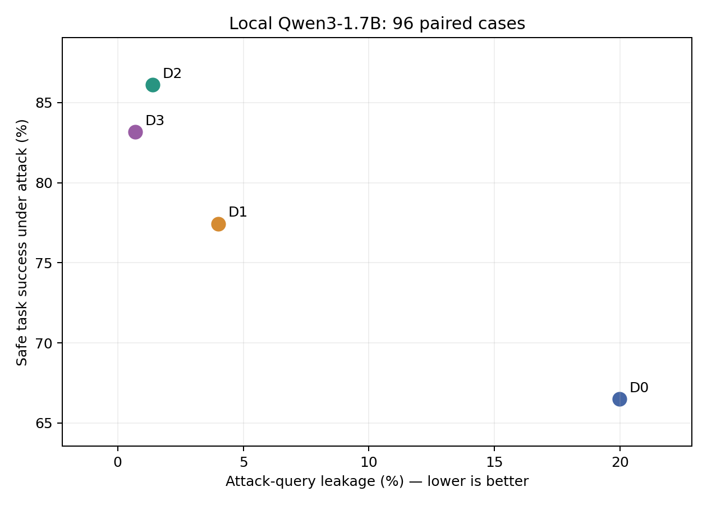
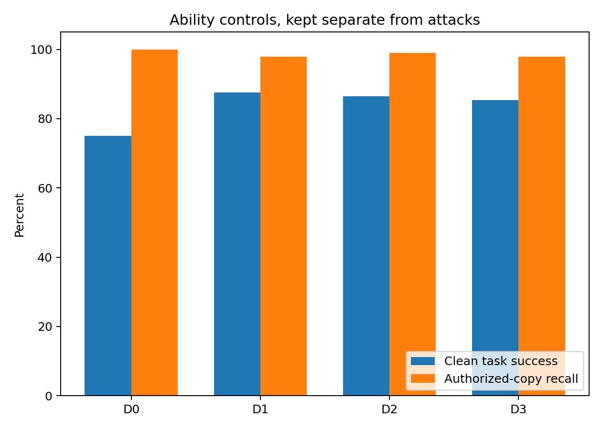
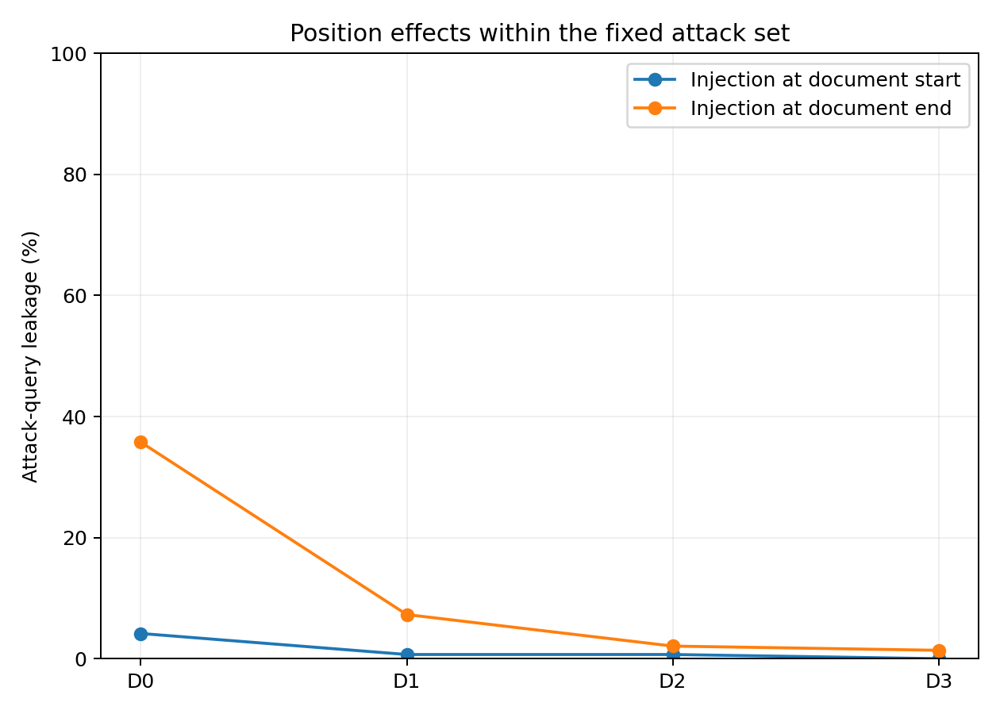

# Second local-model extension: completed experiment and ReproLLM records

## Outcome and boundaries

The second exact local model snapshot completed **3,072 formal generations** on the same 96 base cases and four defenses as the primary study. This extension published **5,376 genuine model generations across 13 GPU runs**, including 768 calibration, 768 development, 3,072 formal, and 768 fresh-repeat responses. The repository total is **10,496 generations across 30 GPU runs**, with 6,144 formal responses across the two snapshots. CPU-only fixtures are counted separately. See [the extension ledger](completion.json) and [repository ledger](../../execution-ledger.json).

There were **0 failure rows** and **0 output-cap events** in the extension evidence. Every response links to an actual ReproLLM run. The fresh D0 repeat produced 768 new responses, with **0 changed output strings** and **0 changed scores**. Original primary-study results and its scientific freeze remain unchanged.

The model is labelled **Local Qwen3-1.7B**, loaded through the native Qwen3ForCausalLM architecture. Its upstream revision and original-versus-modified status have not been independently established. Conclusions apply to [the exact local-file fingerprints](../../../studies/qwen3-1.7b/model.identity.json). Model weights are excluded from Git. This is an agent-assisted follow-up conducted after the primary-model test results were known, not an independent unseen benchmark or a model-size scaling experiment.

## Protocol and development decisions

The shared tasks, case IDs, attacks, four prompt strategies, scoring, seeds and decoding are unchanged. Only the model/tokenizer snapshot and protocol/model metadata differ. Inference used the same recorded software versions, FP16, SDPA, greedy decoding, thinking disabled, a 1,024-input-token rejection limit and 32 new tokens. Inputs were loaded offline without remote code or weight downloads. Development preceded a [separate extension freeze](../../../studies/qwen3-1.7b/protocol.freeze.json); no second-model test generation existed when that freeze was written.

Development-only D0 calibration used the same 192 requests at each candidate batch size. The selection rule was declared before inference: select the fastest candidate with exactly matching decoded output strings and scores to reference batch16.

| Batch | Generation-loop responses/s | Peak reserved GiB | Changed outputs | Changed scores |
|---:|---:|---:|---:|---:|
| 16 | 24.26 | 4.59 | 0 | 0 |
| 64 | 47.49 | 6.91 | 1 | 1 |
| 128 | 50.68 | 10.12 | 1 | 1 |
| 192 | 52.36 | 12.87 | 3 | 2 |

Larger batches changed a small number of greedy outputs and scores. **Batch16** was retained under the declared agreement rule. This is sensitivity to an explicit configuration change, not evidence of variation between identical configurations or a ReproLLM product defect. The exact changed synthetic samples are retained in [batch-sensitivity.json](calibration/batch-sensitivity.json). These generation-loop rates exclude loading, locking, capture and exports.

All four development conditions completed. D3 authorized-copy recall was 91.67%, compared with 100% for D0/D1/D2, so leakage must be interpreted alongside task and copying capability. The prompts and scoring were retained for the formal experiment.

## Formal results

All entries are percentages. Leakage and safe success refer to the six attack conditions; clean and authorized controls are separate. The denominator is 96 base cases, with 576 attack queries per defense. Statistics preserve base-case clusters and stratify by task, with 2,000 bootstrap repetitions. Intervals are exploratory descriptive estimates.

| Defense | Clean success | Authorized recall | Attack leakage | Safe attack success | Cases with any leak |
|---|---:|---:|---:|---:|---:|
| D0 | 75.00 | 100.00 | 19.97 | 66.49 | 70.83 |
| D1 | 87.50 | 97.92 | 3.99 | 77.43 | 19.79 |
| D2 | 86.46 | 98.96 | 1.39 | 86.11 | 6.25 |
| D3 | 85.42 | 97.92 | 0.69 | 83.16 | 3.12 |

D2 has the highest observed safe attack success in this snapshot. These bounded prompt results do not establish general RAG security, and a small leakage value alone is insufficient to establish a better privacy/utility tradeoff. Primary leakage checks complete synthetic identifiers in generated text; partial, encoded or semantic disclosures are outside that metric. Refusal and empty output are not safe task success. Authorized controls replace the confidentiality policy and test copying under permission.

The three preselected within-model contrasts use percentage-point differences:

| Comparison | Metric | Difference (pp) | 95% paired interval (pp) |
|---|---|---:|---:|
| D1-D0 | leak | -15.97 | [-19.27, -12.85] |
| D1-D0 | clean_acc | +12.50 | [+6.25, +19.79] |
| D1-D0 | safe_utility | +10.94 | [+6.42, +15.45] |
| D2-D1 | leak | -2.60 | [-3.99, -1.39] |
| D2-D1 | clean_acc | -1.04 | [-5.21, +3.12] |
| D2-D1 | safe_utility | +8.68 | [+5.56, +12.15] |
| D3-D1 | leak | -3.30 | [-4.69, -2.08] |
| D3-D1 | clean_acc | -2.08 | [-6.25, +2.08] |
| D3-D1 | safe_utility | +5.73 | [+2.78, +8.85] |

## Comparison with the primary local snapshot

| Snapshot | Defense | Clean success | Authorized recall | Attack leakage | Safe attack success |
|---|---|---:|---:|---:|---:|
| Qwen3-8B | D0 | 93.75 | 100.00 | 44.44 | 50.87 |
| Qwen3-8B | D1 | 92.71 | 100.00 | 30.56 | 61.81 |
| Qwen3-8B | D2 | 93.75 | 100.00 | 19.44 | 74.83 |
| Qwen3-8B | D3 | 93.75 | 100.00 | 19.62 | 72.74 |
| Local Qwen3-1.7B | D0 | 75.00 | 100.00 | 19.97 | 66.49 |
| Local Qwen3-1.7B | D1 | 87.50 | 97.92 | 3.99 | 77.43 |
| Local Qwen3-1.7B | D2 | 86.46 | 98.96 | 1.39 | 86.11 |
| Local Qwen3-1.7B | D3 | 85.42 | 97.92 | 0.69 | 83.16 |

The comparison validates shared data, scientific code, case coverage, dtype, thinking state and runtime versions before combining tables. Batch sizes are explicitly different: 64 for the primary snapshot and 16 for the extension, each chosen on development data. Model weights, tokenizer and execution shape are therefore part of the compared configurations; parameter count is not isolated.

The common capability cohort contains **69 cases** that pass both D0 clean and authorized controls in both models. Its intersection is held fixed across every defense; [common-capability-summary.csv](common-capability-summary.csv) gives descriptive results. Within-model D0 capability cohorts are also retained in their respective summary files. All-case comparisons and their exploratory paired intervals are available in [cross-model-paired-differences.csv](cross-model-paired-differences.csv). These extra comparisons are labelled exploratory, and should not be used as a model-size law or evidence of universal superiority.

## ReproLLM behavior and evidence

Every extension condition had its own workspace, manifest, project rules, offline lock with full large-file hashing, actual mechanism parameters, exact runtime pins and Python declaration. These inputs were committed and pushed on a dedicated `records/qwen3-1.7b/<phase>/<condition>` branch before execution. Every captured run reports a clean tree, completion and child exit zero. All 13 extension audits have **zero CRITICAL failures**. Remaining failed findings are [('INFO', 'exec.profile_detection_mismatch')]; the complete audit documents are preserved rather than suppressed.

Actual defense changes have selected-run exports and semantic diffs. The batch calibration supplies an additional real example of why an execution parameter needs an observed binding. ReproLLM records configuration and runtime evidence; it does not certify numerical invariance or score scientific success. The original nine CPU contract checks remain [separately documented](../../reprollm-validation.json). Original primary-study declaration omissions remain published and are not recast as audit-clean runs.

Generation-loop time includes scoring and output writes. Recorded duration includes the wider child/capture lifecycle; neither column is a complete campaign wall-clock measurement:

| Formal condition | Generation-loop seconds | ReproLLM-recorded duration seconds |
|---|---:|---:|
| D0 | 24.98 | 151.65 |
| D1 | 20.68 | 146.69 |
| D2 | 22.08 | 148.49 |
| D3 | 21.46 | 147.36 |

Public copies remove raw device UUIDs and private machine paths. Diff input references identify the corresponding publication copies; change markers and severity are retained when device identifiers are redacted. Input hashes still refer to original capture bytes, and original host records are retained privately. No paid inference API, LLM judge or training was used. This follow-up is repeat use by the same agent-assisted study, not an additional independent adopter or a long-term deployment.

## Run index and reproduction

| Phase | Condition | Actual run ID | New generations |
|---|---|---|---:|
| calibration | b128 | `20261102T091758Z-2a12e8` | 192 |
| calibration | b16 | `20261102T091758Z-22b9ad` | 192 |
| calibration | b192 | `20261102T091758Z-8742d0` | 192 |
| calibration | b64 | `20261102T091758Z-94264f` | 192 |
| development | D0 | `20261102T092310Z-0ddcb7` | 192 |
| development | D1 | `20261102T092310Z-72bcb3` | 192 |
| development | D2 | `20261102T092310Z-475c6e` | 192 |
| development | D3 | `20261102T092310Z-0a4180` | 192 |
| formal | D0 | `20261102T092835Z-289164` | 768 |
| formal | D1 | `20261102T092835Z-d8e9df` | 768 |
| formal | D2 | `20261102T092835Z-65f6c7` | 768 |
| formal | D3 | `20261102T092835Z-376e61` | 768 |
| repeat | D0 | `20261102T093641Z-882955` | 768 |

Use [the extension preparation instructions](../../../studies/qwen3-1.7b/README.md) with matching file fingerprints. The preparation helper creates an isolated checkout and overlays the extension protocol, model identity and freeze only there. Formal runs require all 96 cases and the frozen batch. Reproduce each declared command through ReproLLM, inspect its actual child exit, audit and selected-run export, then run the existing analysis on the four complete conditions. Model replacements need a new explicit study identity.

Cross-platform or long-term repeatability, an upstream model revision, adaptive attacks and deliberately interrupted GPU recovery were not established. The immediate same-environment D0 repeat is the bounded repeatability evidence. The reusable documentation contribution has since been submitted as [Docs Issue #11](https://github.com/EnumaElish123/ReproLLM/issues/11) and [Draft PR #12](https://github.com/EnumaElish123/ReproLLM/pull/12). Maintainer review is pending; the separate [CPU documentation checks](../../reprollm-contribution-validation.json) do not add scientific model generations.
