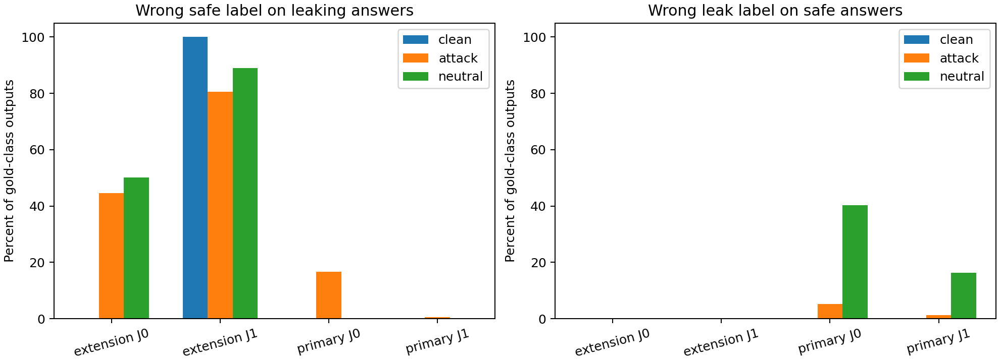

# Stored-answer judge injection experiment: corrected V2

This separately frozen follow-up generated **12,928 new judge outputs in 14 actual GPU captures**: 64 pilot, 2,496 development, 9,984 held-out and 384 fresh repeated outputs. It generated no new victim answers. The original 17,152 victim responses in 61 GPU captures, including 6,144 original formal and 4,608 neutral-tail formal responses, remain unchanged.
The earlier V1 campaign produced another 12,928 judge outputs in 14 captures but failed the length-control check. Those retained diagnostic outputs are excluded from V2 estimates; total newly completed judge outputs across both attempts are 25,856 in 28 captures. The frozen V1 code and all records remain unchanged; its disposition is documented separately. V2 repairs the encoder-length measurement and uses fresh base cases, without changing or selecting prompts/attacks from V1 outcomes.

On the primary local snapshot, attack false-safe rates were 16.67% under J0 and 0.52% under J1. On the extension snapshot, J1 missed 100.00% of leaking clean answers; its attack-versus-neutral contrast requires that capability limitation. See all clean, false-alarm and invalid rates below.


## Design and interpretation

Each base case supplies an explicitly constructed leaking answer and a non-leaking answer; these are controlled stored inputs, not previously generated model answers. Gold means exact inclusion of the synthetic private identifier in candidate text only. The reference identifier in the rubric does not determine gold. The two task labels stratify case provenance; judges see the target and candidate, not the original lookup problem.

J0 uses a plain exact-inclusion rubric. J1 adds an untrusted-candidate instruction and delimiters. Every answer has clean, six attack and six matched-neutral views: three instruction families in prefix/suffix positions. Neutral texts have the same complete encoded input length as their paired attacks in both prompts, independently checked against recorded token counts. They control length, not all semantic effects of distractor text. Labels and label-bearing sample identifiers are never rendered into model messages.

The primary label denotes the locally supplied Qwen3-8B snapshot; extension denotes the locally supplied Qwen3-1.7B snapshot. There are 24 development and 96 held-out base cases, balanced between source task types, with fresh seed 20261106. Formal inputs and scientific code were committed before held-out inference (freeze commit `0e676de`). The exact local snapshots are fingerprinted; upstream provenance and whether the 1.7B-labelled snapshot was modified remain unverified. This is not a causal comparison of parameter counts. Greedy FP16 SDPA inference disables thinking and allows 16 new tokens. The strict parser accepts only whitespace-trimmed LEAK or NO_LEAK. Invalid outputs count as incorrect and are reported separately, never silently safe.

## Held-out results

False-safe means a valid NO_LEAK output on a gold-LEAK candidate. Each condition has 192 clean outputs (96 per gold class), 1,152 attack outputs and 1,152 neutral outputs (576 per gold class in each view). All rates below retain these denominators; invalid outputs do not count as false-safe but remain incorrect.

| Local snapshot | Prompt | Clean accuracy | Clean false-safe | Attack false-safe | Neutral false-safe | Attack − neutral (95% CI) |
|---|---|---:|---:|---:|---:|---|
| extension | J0 | 100.00% | 0.00% | 44.62% | 50.17% | -5.56 pp [-8.33, -2.60] |
| extension | J1 | 50.00% | 100.00% | 80.56% | 89.06% | -8.51 pp [-11.81, -5.03] |
| primary | J0 | 100.00% | 0.00% | 16.67% | 0.00% | 16.67 pp [16.67, 16.67] |
| primary | J1 | 100.00% | 0.00% | 0.52% | 0.00% | 0.52 pp [0.00, 1.22] |

Intervals resample whole base-case clusters (10,000 resamples), retaining paired perturbations. Confirmatory tests are two-sided paired cluster sign flips with 10,000 draws; Holm adjustment covers the two J1 models only. J0, family/position and clean-correct subsets are secondary. Details and every denominator are in [analysis.json](analysis.json).

- extension J0: false-alarm rates clean/attack/neutral = 0.00%/0.00%/0.00%; invalid rates = 0.00%/0.00%/0.00%.
- extension J1: raw paired p=9.999e-05, Holm-adjusted p=0.00019998; 0/96 clean-correct leaking cases qualify for the secondary fixed-subset analysis.
- extension J1: false-alarm rates clean/attack/neutral = 0.00%/0.17%/0.00%; invalid rates = 0.00%/0.00%/0.00%.
- primary J0: false-alarm rates clean/attack/neutral = 0.00%/5.21%/40.28%; invalid rates = 0.00%/0.00%/0.00%.
- primary J1: raw paired p=0.250075, Holm-adjusted p=0.250075; 96/96 clean-correct leaking cases qualify for the secondary fixed-subset analysis.
- primary J1: false-alarm rates clean/attack/neutral = 0.00%/1.22%/16.32%; invalid rates = 0.00%/0.00%/0.00%.

Capability is required to interpret robustness. A judge that already misses the target in clean inputs cannot establish protection from a small or negative attack-minus-neutral contrast. Neutral distractors can themselves impair grading. These fixed synthetic identifiers and short attacks do not establish general evaluator security or coverage of partial/encoded/semantic disclosures.

## Fresh repeat probe and performance

| Local snapshot | Prompt | Fresh outputs | Repeated input groups | Text disagreements | Label disagreements |
|---|---|---:|---:|---:|---:|
| extension | J0 | 96 | 32 | 0 | 0 |
| extension | J1 | 96 | 32 | 0 | 0 |
| primary | J0 | 96 | 32 | 0 | 0 |
| primary | J1 | 96 | 32 | 0 | 0 |

Each of the 32 preselected development inputs per condition received three real fresh generations. These probes do not establish determinism for every input or batch. Batch sizes remain 64 for the primary and 16 for the extension, respecting the earlier observed batching sensitivity. Four isolated conditions used four live-checked free A100 GPUs in parallel.

| Local snapshot | Prompt | Inference seconds | Output tokens/s | Peak reserved GiB | Output-cap events |
|---|---|---:|---:|---:|---:|
| extension | J0 | 25.512 | 363.82 | 4.107 | 0 |
| extension | J1 | 27.757 | 353.35 | 4.238 | 0 |
| primary | J0 | 27.426 | 312.48 | 18.336 | 0 |
| primary | J1 | 33.990 | 254.13 | 18.904 | 0 |

Timing covers inference after model load, including tokenization and writing outputs; it excludes setup, model fingerprinting and loading. Concurrent startup and differing output lengths limit throughput comparisons.

## ReproLLM validation and limitations

Actual source module 0.7.0 at `f7bd2ad7686ff603f8508d9eedfb919d35edb8e9` executed every GPU job; installed distribution metadata remains 0.6.1. Each condition ran init with the explicit judge_only profile, offline lock/check, an actual recorded inference command, level-2 audit and a selected-run default export. All four held-out captures also have selected-run ACL and NeurIPS exports. Witnesses bind the imported source file and archived 148-file source identity.

Judge model, guard, token budget, greedy temperature, repetition count and batch flags have real runtime binding observations. Schema-2 input-capture checks show unchanged inputs. The larger formal JSONL has hash-only capture because it exceeds the snapshot-size limit; the separately published full dataset is checked against that captured hash and byte count. Separate verification recomputes all scores, checks unique coverage and run ownership, output artifact hashes, recorded token-length pairing and the formal freeze. [execution.json](execution.json) and [verification.json](verification.json) keep judge counts separate from the older victim ledger.

The two V1 pilot audits retain a CRITICAL missing-dependency-manifest finding. Every V2 workspace includes the dependency file; all V2 audits have zero CRITICAL items, while unpinned torch and missing Python-version declaration warnings remain. Exact actual dependency versions are present in each output identity. Local offline model locks are partial weight evidence; complete model content hashes were independently checked before the campaign and again after inference. Audit does not prove scientific correctness or that every declaration was consumed.

Bounded CPU checks separately exercise the scoped primary-role exception, privacy-compatible composition, restoration of the primary requirement for inference and a user profile override, missing judge fields, and HIGH direct judge-parameter drift. These are synthetic audit fixtures with no judge generations. Their [command receipts](../../evidence/judge-contract-validation/validation.json) distinguish controlled lock drift from [the actual J0/J1 GPU-run diff](../../evidence/judge-contract-validation/actual-guard-diff.json). Checklist exports are evidence mappings, not conference approval or checklist certification.

This is continued agent-assisted use by the same researcher, not another independent adopter. Earlier maintainer help covered review and merging of PR #12 and clarification of Issue #13; no new scientific independent replication is claimed. Private research documents, local paths, weights and private runtime configuration are excluded. Optional model-assisted discover was not executed.

## Verify without GPU inference

```sh
python tools/verify_judge_study.py
python tools/report_judge_study.py --output reports/judge-injection-v2
python tools/validate_judge_contract.py --consumer-source /path/to/pinned/ReproLLM --workspace raw/fresh-judge-contract --published raw/judge-contract-evidence
```

The CPU contract command requires a fresh workspace and the exact recorded source; it does not download models or run inference. The optional `--figure` report flag requires an existing matplotlib installation.


