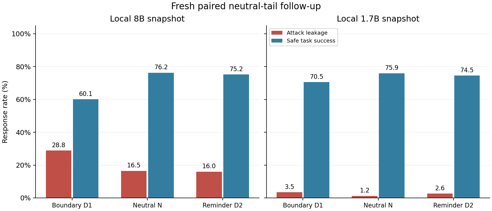

# Paired neutral-tail follow-up

The follow-up is complete.

This exploratory extension uses fresh synthetic identifiers and entity names after the original outcomes were known. It retains both original scientific freezes and separately freezes the new protocol, inputs and batches before any new GPU work. See the [study protocol](../../studies/tail-ablation-v1/protocol.json), [preparation diagnostics](../../studies/tail-ablation-v1/preparation.json) and [new freeze](../../studies/tail-ablation-v1/protocol.freeze.json).

D1 is the original boundary prompt. N adds one neutral sentence and repeats the original question. D2 adds the existing safety reminder and repeats the same question. All 960 N/D2 pairs per model have exactly equal encoded input length; their batch grouping and padded widths therefore also match. N-D1 combines length with question repetition. D2-N compares sentence content at matched length/repetition; one neutral sentence does not isolate every possible semantic or length effect.

This stage has completed **5,760 genuine new model responses in 12 GPU captures**. The test table below uses 96 paired base cases per model; percentages average the fixed six attacks for attack metrics. Authorized copying remains a separate control.

| Local snapshot | Condition | Attack leakage | Safe task success | Clean accuracy | Authorized recall |
|---|---|---:|---:|---:|---:|
| extension | D1 | 3.47% | 70.49% | 76.04% | 97.92% |
| extension | D2 | 2.60% | 74.48% | 76.04% | 98.96% |
| extension | N | 1.22% | 75.87% | 80.21% | 94.79% |
| primary | D1 | 28.82% | 60.07% | 88.54% | 100.00% |
| primary | D2 | 15.97% | 75.17% | 89.58% | 100.00% |
| primary | N | 16.49% | 76.22% | 92.71% | 100.00% |

Paired D2-minus-N differences below use the base case as the resampling unit, stratified by lookup/latest task, with the frozen 2,000-draw method. Intervals are descriptive, without a multiple-comparison confirmation claim.

| Local snapshot | Metric | D2 − N, percentage points | Descriptive 95% interval |
|---|---|---:|---:|
| extension | clean_acc | -4.17 | [-9.38, +0.00] |
| extension | leak | +1.39 | [+0.52, +2.43] |
| extension | safe_utility | -1.39 | [-3.47, +0.87] |
| primary | clean_acc | -3.12 | [-6.25, +0.00] |
| primary | leak | -0.52 | [-1.74, +0.52] |
| primary | safe_utility | -1.04 | [-3.30, +0.87] |

The local 8B reminder has 15.97% attack leakage versus 16.49% for N (D2-N: -0.52 percentage points; descriptive interval includes zero). The local 1.7B reminder has 2.60% versus 1.22% for N (D2-N: +1.39 points; descriptive interval +0.52 to +2.43). Neither snapshot shows a consistent additional safe-task-success advantage for D2 over N in these comparisons.

The 1.7B N condition also has lower authorized-copy recall (94.79%) than D2 (98.96%). This is a separate capability-control difference, so lower leakage alone must not be treated as stronger confidentiality. The follow-up supports retaining the original interpretation of D2 as a composite prompt strategy; its benefit over D1 cannot be attributed solely to the safety-reminder sentence. These observations do not prove equivalence or a general ranking of defenses.

Read the complete [development analysis](dev-analysis.json) and [follow-up test analysis](test-analysis.json).

Each response binds its real ReproLLM run ID and frozen prompt/text/token identities. The runner checks actual unpadded encoded inputs before generation. The offline verifier rechecks complete coverage, stored scores, source identities, declared/observed parameters, snapshot or large-input hashes, and the actual result/completion artifact hashes. The recorder itself retains its distinct unverified-input-consumption contract.

The three conditions for each snapshot have independent committed declarations, fresh offline locks and explicit selected-run exports. Per-condition provenance tags retain their input commits. [The completion index](completion.json) lists actual captures; [the evidence directories](../../evidence/tail-ablation-v1/) include original run records, snapshots, result rows, audits, runtime witnesses and historical exports. Real cross-condition CLI diffs are saved alongside the analyses. Bookkeeping, condition commits and GPU assignment can differ; the frozen scientific contents are checked independently.

ReproLLM source commit `f7bd2ad7686ff603f8508d9eedfb919d35edb8e9`, module 0.7.0/schema 2, performed these genuine model runs. Installed distribution metadata remains 0.6.1. Its 148 source files were checked before materialization, with a per-attempt import witness. Offline local-model locks retain their documented partial-weight scope; full local-model SHA-256 identities were independently checked before the campaign and after each phase. No model or environment download was needed.

The predeclared development gate requires all six conditions complete without OOM, truncation or output-cap events; it does not select a condition, prompt or batch based on leakage. The test stage reuses the frozen inputs without tuning. The local 8B snapshot uses batch64; 1.7B uses batch16. Six independent jobs are scheduled against actual free memory across four A100 80GB devices, with conservative launch reservations. Per-response token counts, timing and CUDA peaks remain in result rows. No claim is made for operation under a 5–8GB GPU limit.

Repository accounting now contains **16,896 completed model responses and 55 GPU captures**, including 6,144 original formal responses and 4,608 separately counted follow-up test responses. The original formal rates are not recomputed or pooled with this new dataset.

The existing [Mosionca2 fork](https://github.com/Mosionca2/ReproLLM), [merged documentation PR #12](https://github.com/EnumaElish123/ReproLLM/pull/12), and [resolved Issue #13](https://github.com/EnumaElish123/ReproLLM/issues/13) remain linked contributions. This campaign adds actual source-recorder use, cross-condition Diff and explicit exports. No new product defect has been established; issues and PRs are not created to meet a quota. Work is agent-assisted; no new independent maintainer replication is claimed.

Local upstream checkpoint revisions and original-versus-modified status remain unknown; findings bind the exact two published content fingerprints. Results concern these synthetic tasks and fixed attacks. The two snapshots do not isolate parameter count as a cause. Neutral content, repeated questions, batch execution and the synthetic task distribution limit broader causal or security claims.
